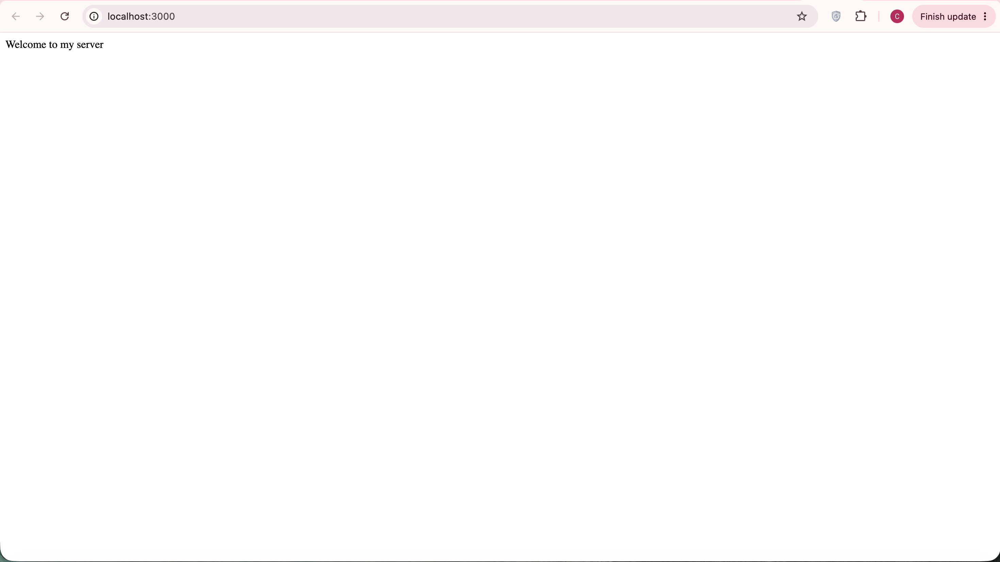
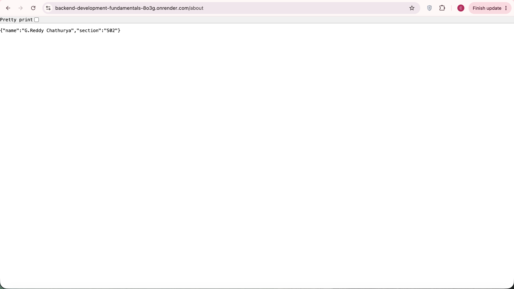
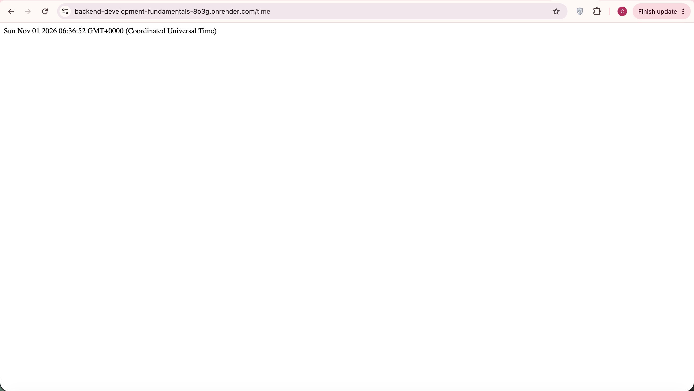
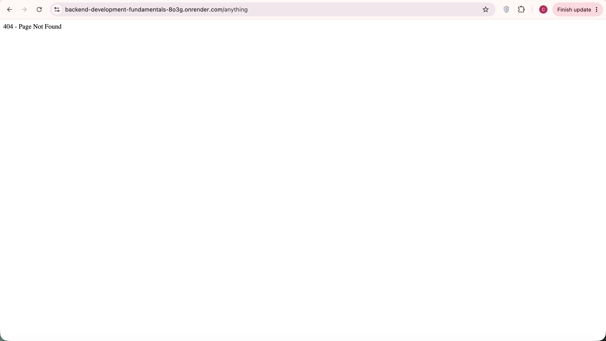

# Lab 1: Node.js and Express Server

**Name:** G. Reddy Chathurya 
**Registration Number:** 252U1R6087  
**Section:** S02

## Live Link

Not deployed yet.

## Objective

To create a web server using Node.js and Express.js, implement different GET routes, and understand how a server handles requests and responses.

## Technologies Used

- Node.js
- Express.js
- JavaScript
- Git and GitHub

## How to Run

### Prerequisites

Install Node.js and npm.

### Installation

Clone the repository:

```bash
git clone https://github.com/chathurya60/Backend-Development-Fundamentals.git
```

Navigate to the lab folder:

```bash
cd Backend-Development-Fundamentals/lab-01
```

Install dependencies:

```bash
npm install
```

Start the Express server:

```bash
node app.js
```

The server will run at:

http://localhost:3000

## Endpoints

| Method | Path | Description |
|---|---|---|
| GET | `/` | Displays the welcome message |
| GET | `/about` | Returns name and section as JSON |
| GET | `/time` | Displays the current date and time |
| GET | `/hello` | Returns a 404 page not found response |

## Screenshots

### 1. Home Page

Displays the welcome message.



### 2. About Page

Displays the name and section in JSON format.



### 3. Time Page

Displays the current date and time.



### 4. 404 Page

Displays the error message for an unknown route.



## Notes

This lab helped me understand the basics of Node.js and Express.js. I learned how to create a server, define routes, handle requests and responses, and return appropriate status codes. I also learned how to use Git and GitHub to maintain and submit my project.