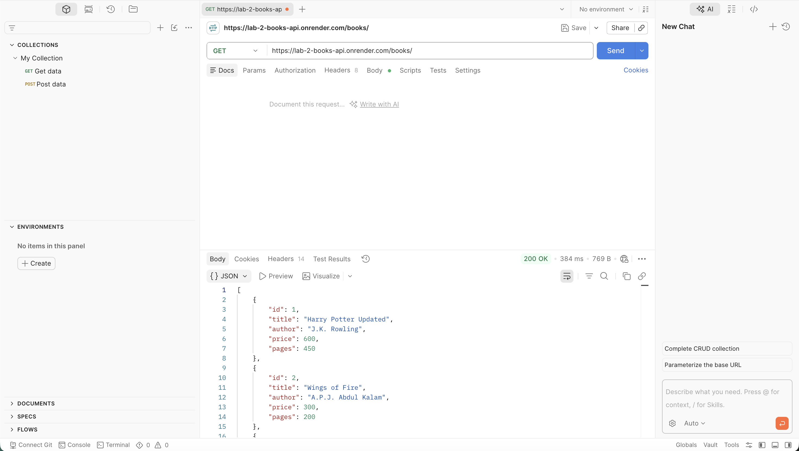
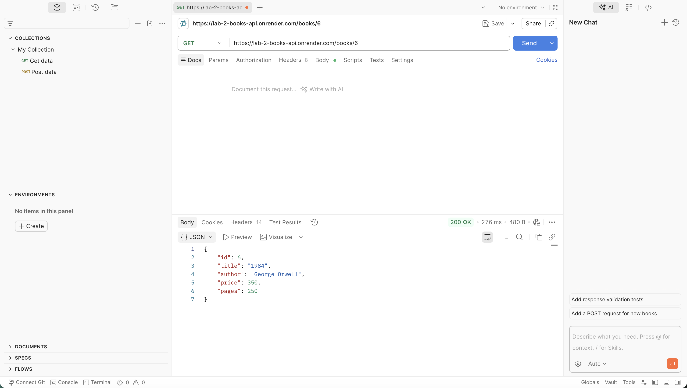
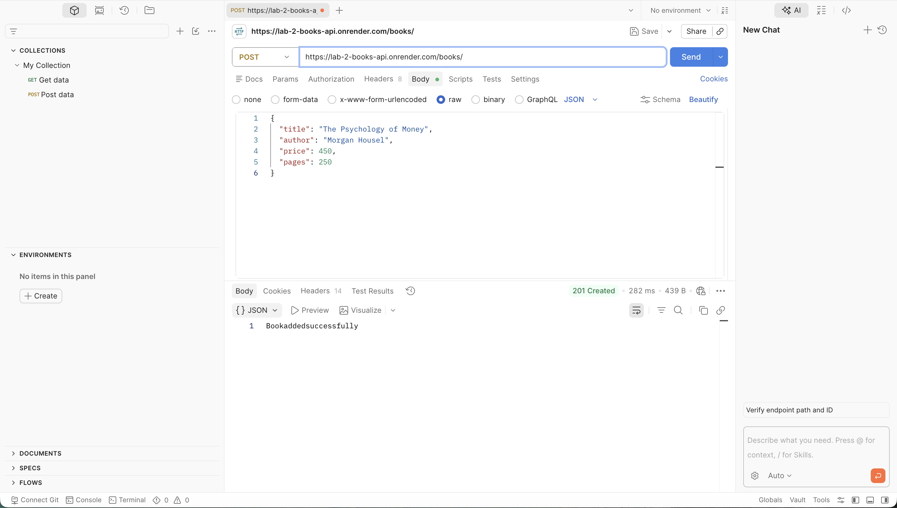
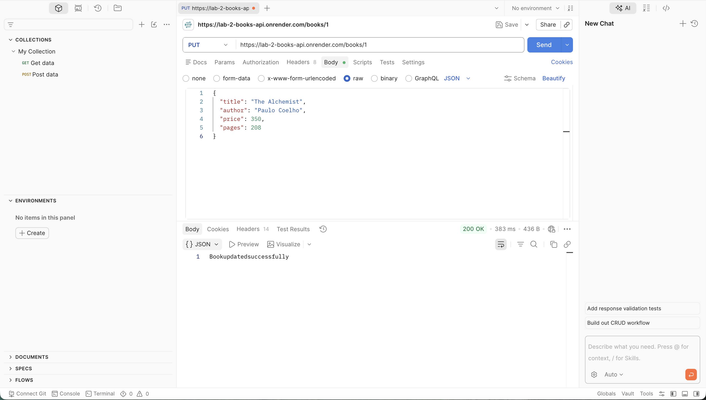
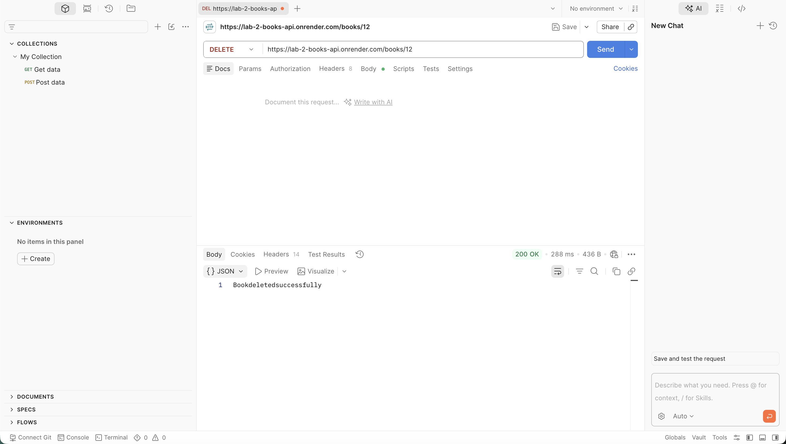

# Lab 2: SQLite Database and CRUD Routes

**Name:** G. Reddy Chathurya  
**Registration Number:** 252U1R6087
**Section:** S02

## Live Link

Not deployed yet.

## Objective

To connect an Express.js server to an SQLite database and implement CRUD (Create, Read, Update, Delete) operations through HTTP routes. This lab helps in understanding database integration, SQL queries, and handling client requests using Express.js.

## Technologies Used

- Node.js
- Express.js
- SQLite
- sqlite3
- JavaScript
- Postman
- Git and GitHub

## How to Run

### Prerequisites

Install Node.js, npm, and SQLite.

### Installation

Clone the repository:

```bash
git clone https://github.com/chathurya60/Backend-Development-Fundamentals.git
```

Navigate to the lab folder:

```bash
cd Backend-Development-Fundamentals/lab-02
```

Install dependencies:

```bash
npm install
```

Start the Express server using nodemon:

```bash
npm run dev
```

The server will run at:

[http://localhost:3000](http://localhost:3000)

## Endpoints

| Method | Path | Description |
| ------ | -------- | ------------------------------------- |
| GET | `/books/` | Retrieves all books from the database |
| GET | `/books/:bookId/` | Retrieves a specific book by its ID |
| POST | `/books/` | Adds a new book to the database |
| PUT | `/books/:bookId/` | Updates an existing book by its ID |
| DELETE | `/books/:bookId/` | Deletes a book from the database by its ID |

## Screenshots

### 1. GET All Books

Displays all book records stored in the SQLite database.



### 2. GET One Book

Displays the details of a specific book using its ID.



### 3. POST Book

Adds a new book to the database and displays the success response.



### 4. PUT Book

Updates the details of an existing book and displays the success response.



### 5. DELETE Book

Deletes a book from the database and displays the success response.



### 6. Database View

Displays the book records in the SQLite database after performing CRUD operations.


## Notes

This lab helped me understand how to integrate an SQLite database with a Node.js and Express.js application. I learned how to create a database table, insert records, and implement CRUD operations using HTTP methods. I also learned how to use parameterized SQL queries to prevent SQL injection and how to test API endpoints using Postman. The lab improved my understanding of asynchronous database operations using async/await and how to verify database changes using the SQLite CLI.
