# Lab 3: REST API with Search, Sorting, Pagination and Filtering

**Name:** G. Reddy Chathurya  
**Registration Number:** 252U1R6087  
**Section:** S02

## Live Link

[View Live Application](https://lab-03-books-api-t8xd.onrender.com/)

## Objective

To connect an Express.js server to an SQLite database and implement CRUD (Create, Read, Update, Delete) operations through HTTP routes. This lab also focuses on implementing search, sorting, pagination, price filtering, and input validation using query parameters and SQL queries.

## Technologies Used

- Node.js
- Express.js
- SQLite
- sqlite3
- JavaScript
- Postman
- Git and GitHub

## How to Run

### Prerequisites

Install Node.js, npm, and SQLite.

### Installation

Clone the repository:

```bash
git clone https://github.com/chathurya60/Backend-Development-Fundamentals.git
```

Navigate to the lab folder:

```bash
cd Backend-Development-Fundamentals/lab-03
```

Install dependencies:

```bash
npm install
```

Start the Express server:

```bash
npm start
```

The server will run at:

http://localhost:3000

## Endpoints

| Method | Path | Description |
|---|---|---|
| GET | `/books/` | Retrieves all books with search, sorting, pagination and price filtering |
| GET | `/books/:bookId/` | Retrieves a specific book using its ID |
| POST | `/books/` | Adds a new book to the database |
| PUT | `/books/:bookId/` | Updates an existing book using its ID |
| DELETE | `/books/:bookId/` | Deletes a book from the database using its ID |

## Query Parameters

| Parameter | Description |
|---|---|
| `search_q` | Searches books by title |
| `order_by` | Specifies the column used for sorting |
| `order` | Specifies ascending (ASC) or descending (DESC) order |
| `limit` | Specifies the number of records to retrieve |
| `offset` | Specifies the number of records to skip |
| `min_price` | Filters books with a minimum price |
| `max_price` | Filters books with a maximum price |

## Screenshots

### 1. GET All Books

Displays all book records stored in the SQLite database.

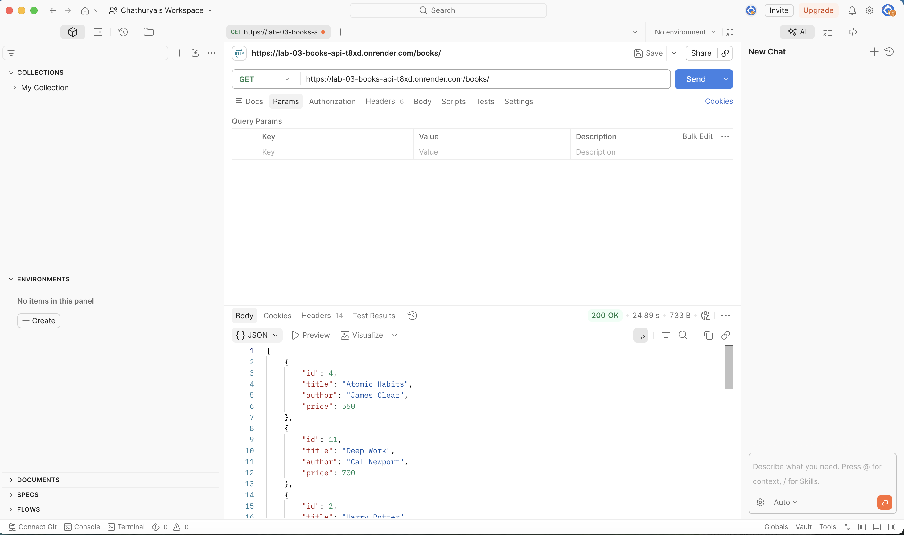

### 2. GET One Book

Displays the details of a specific book using its ID.

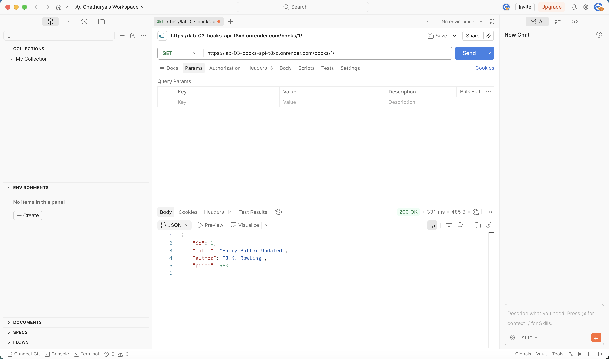

### 3. Search Books

Displays books matching the given search query.

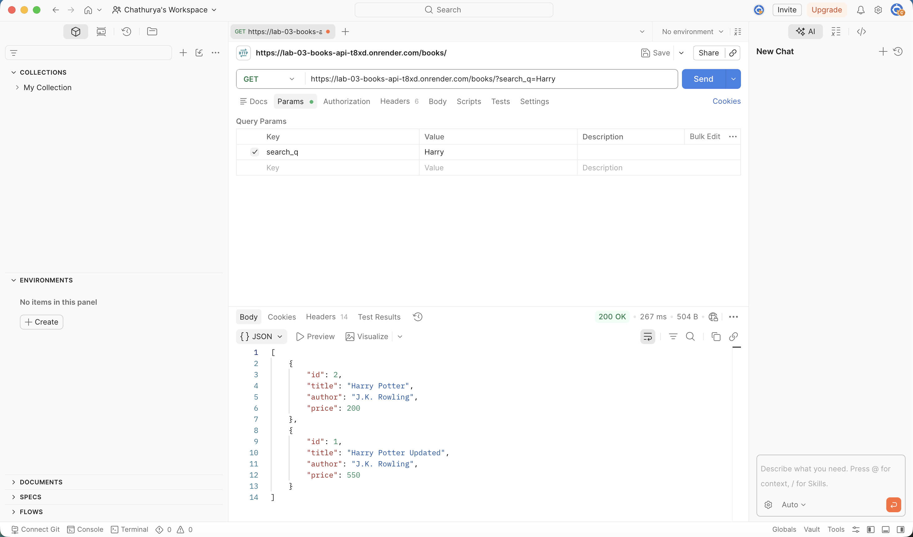

### 4. Sort Books in Ascending Order

Displays books sorted by price in ascending order.

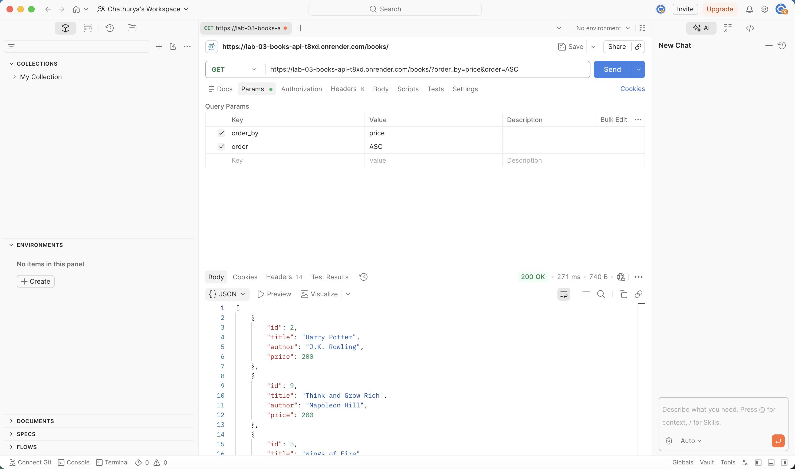

### 5. Sort Books in Descending Order

Displays books sorted by price in descending order.

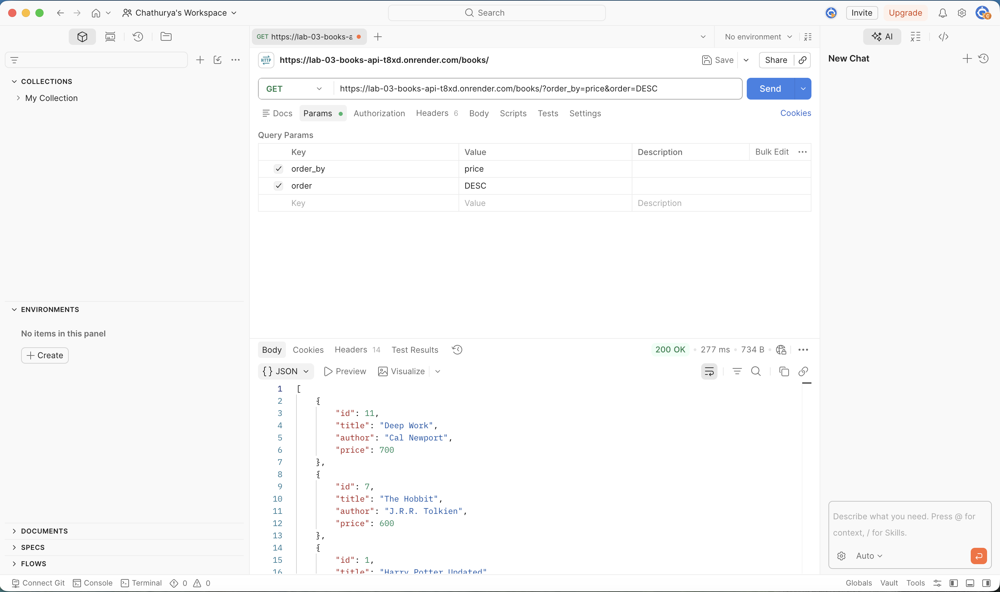

### 6. Pagination

Displays a limited number of book records using limit and offset.

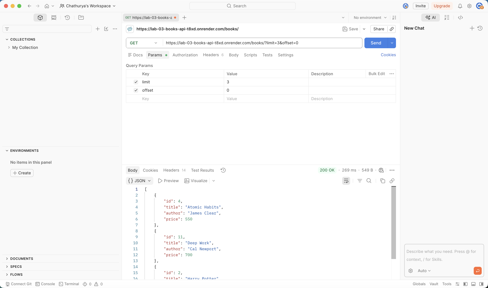

### 7. Filter Books by Minimum Price

Displays books whose price is greater than or equal to the specified minimum price.

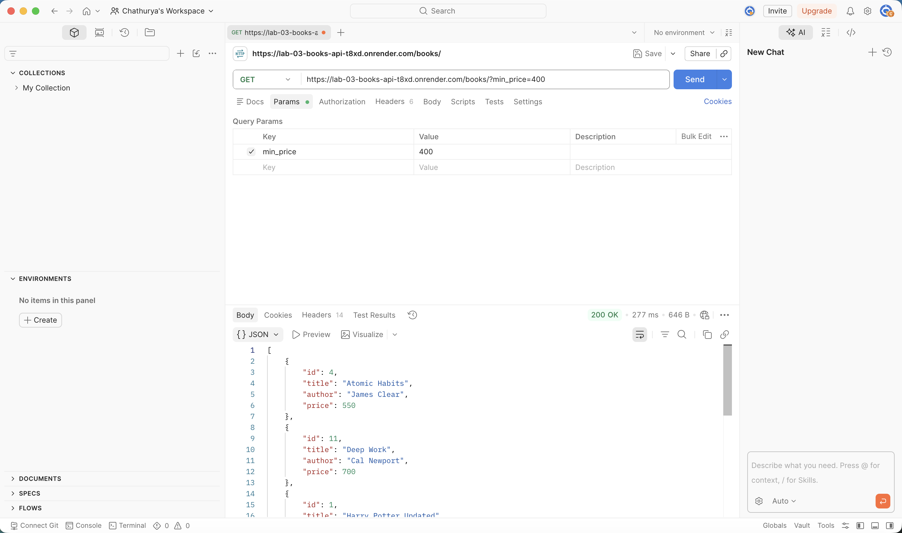

### 8. Filter Books by Maximum Price

Displays books whose price is less than or equal to the specified maximum price.

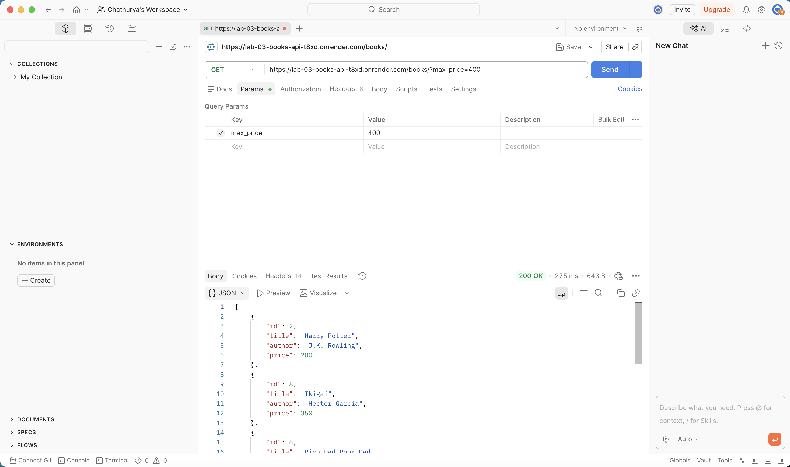

### 9. Filter Books by Price Range

Displays books whose prices fall within the specified minimum and maximum price range.

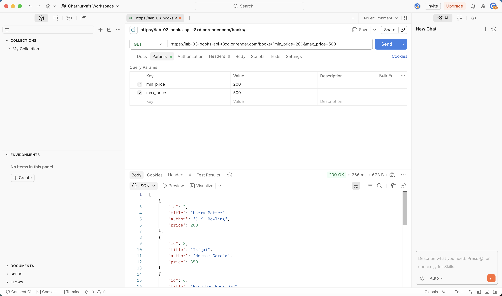

### 10. POST Book

Adds a new book to the database and displays the success response.

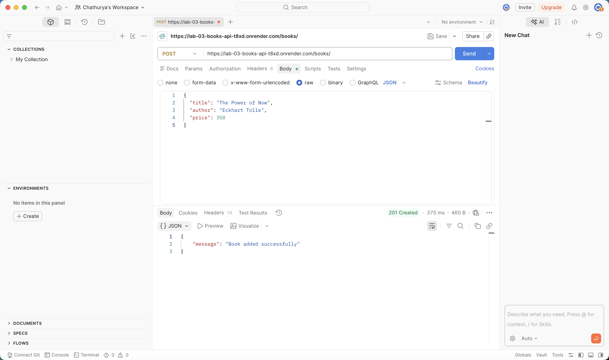

### 11. POST Validation

Displays the 400 Bad Request response when invalid book details are submitted.

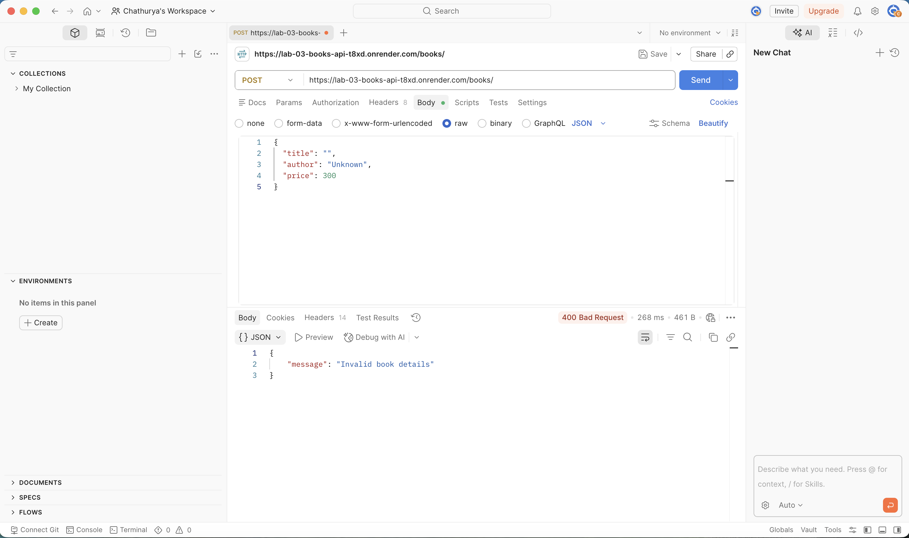

### 12. PUT Book

Updates the details of an existing book and displays the success response.

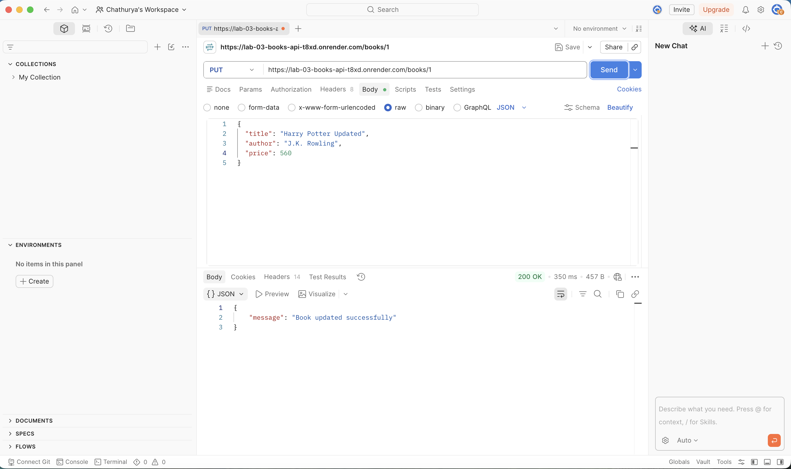

### 13. DELETE Book

Deletes a book from the database and displays the success response.

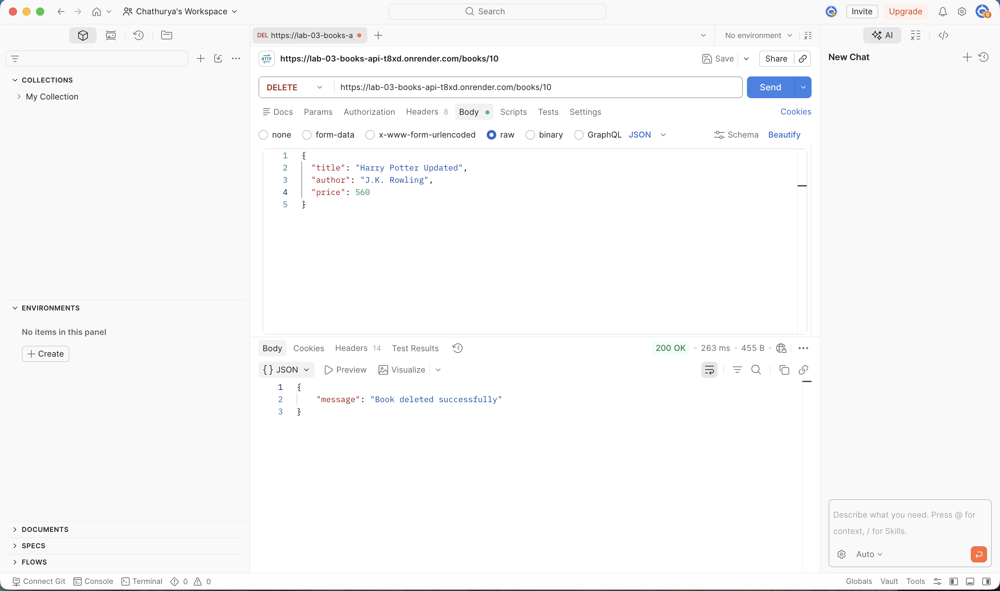

## Notes

This lab helped me understand how to integrate an SQLite database with a Node.js and Express.js application. I learned how to implement CRUD operations, search records using query parameters, sort results in ascending and descending order, apply pagination, and filter books based on price. I also learned how to validate POST requests, handle HTTP status codes, use parameterized SQL queries, and test API endpoints using Postman. The lab improved my understanding of REST API development and database operations.