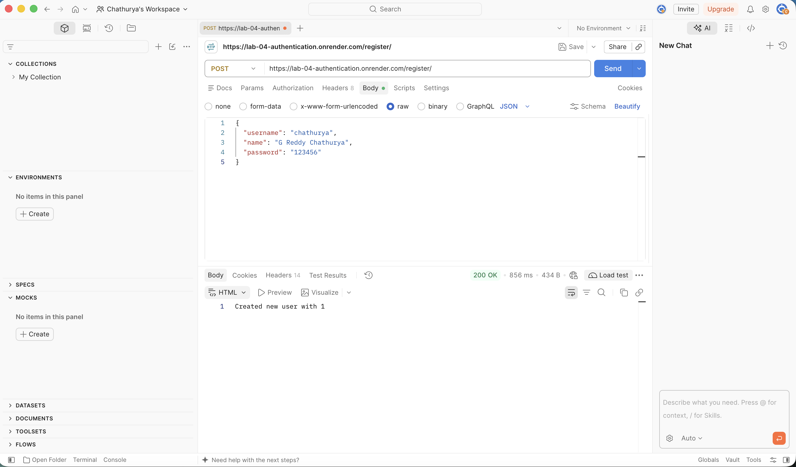
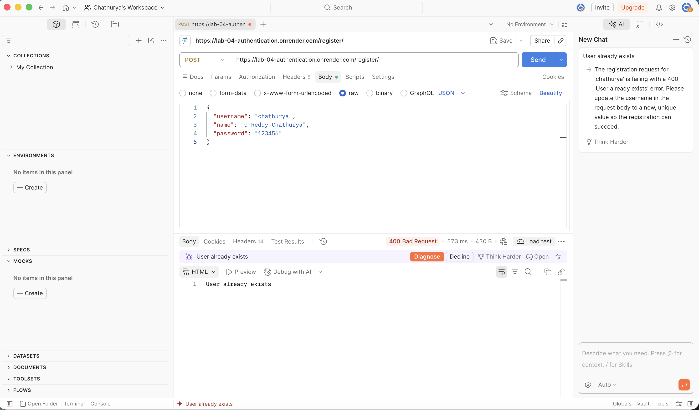
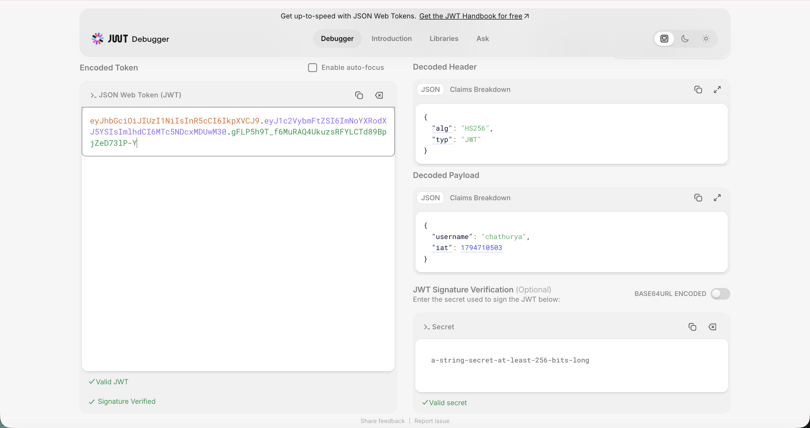

# Lab 4: User Registration, Login and JWT Authentication

**Name:** G. Reddy Chathurya  
**Registration Number:** 252U1R6087  
**Section:** S02

## Live Link

[View Live Application](https://lab-04-authentication.onrender.com/)

## Objective

To develop a user authentication system using Node.js and Express.js with SQLite database integration. This lab focuses on implementing user registration and login functionalities, securely hashing passwords using bcrypt, and generating JSON Web Tokens (JWT) for authentication.

## Technologies Used

- Node.js
- Express.js
- SQLite
- sqlite3
- bcrypt
- jsonwebtoken
- JavaScript
- Postman
- Git and GitHub

## How to Run

### Prerequisites

Install Node.js, npm, and SQLite.

### Installation

Clone the repository:

```bash
git clone https://github.com/chathurya60/Backend-Development-Fundamentals.git
```

Navigate to the lab folder:

```bash
cd Backend-Development-Fundamentals/lab-04
```

Install dependencies:

```bash
npm install
```

Start the Express server:

```bash
npm start
```

The server will run at:

[http://localhost:3000](http://localhost:3000)

## Endpoints

| Method | Path | Description |
|---|---|---|
| POST | `/register/` | Registers a new user and stores the hashed password |
| POST | `/login/` | Verifies user credentials and generates a JWT token |

## Screenshots

### 1. Registration Success

Displays the successful registration of a new user with a unique username.



### 2. Registration Failure

Displays the 400 Bad Request response when attempting to register with an already existing username.



### 3. Login Success

Displays successful login with valid credentials and the generated JWT token.


### 4. Login Failure

Displays the 400 Bad Request response when the user enters an incorrect password.


### 5. JWT Decoded

Displays the decoded JWT token, including its header, payload containing the username, and signature verification.




## Notes
This lab helped me understand how to implement user registration and login functionalities using Node.js, Express.js, and SQLite. I learned how to securely store passwords using bcrypt hashing and compare passwords during login. I also learned how to generate JSON Web Tokens using the jsonwebtoken package and understand the three parts of a JWT: header, payload, and signature. The lab improved my understanding of authentication, password security, and API testing using Postman.