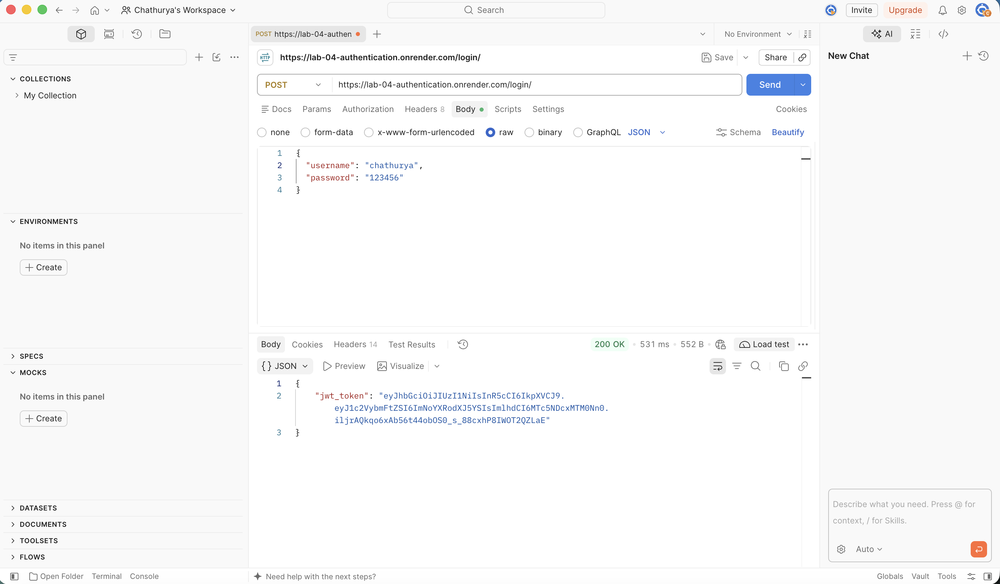
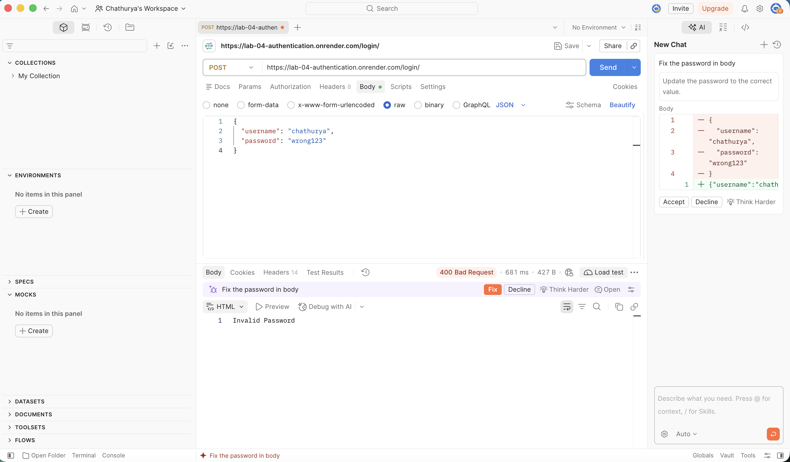

# Lab 4: Registration, Login and JWT

## Student Details
- Name: G. Reddy Chathurya
- Registration Number: 252U1R6087
- Section: S02

## Objective
To implement user registration and login using bcrypt password hashing and JWT authentication.

## Technologies Used
- Node.js
- Express.js
- SQLite
- bcrypt
- jsonwebtoken
- Postman

## Installation

Install dependencies:

npm install

## Run the Project

npm run dev

Server runs at:
http://localhost:3000

## API Endpoints

| Method | Endpoint | Description |
|--------|----------|-------------|
| POST | /register/ | Register a new user |
| POST | /login/ | Login and generate JWT token |

## Features
- User registration
- Password hashing using bcrypt
- Password verification
- JWT token generation
- Duplicate username validation
- Invalid login handling

## Screenshots

### Registration Success

### Registration Failure

### Login Success

### Login Failure

### JWT Decoded

### Database

## Notes
Passwords are stored as bcrypt hashes.
JWT payload contains only the username.
